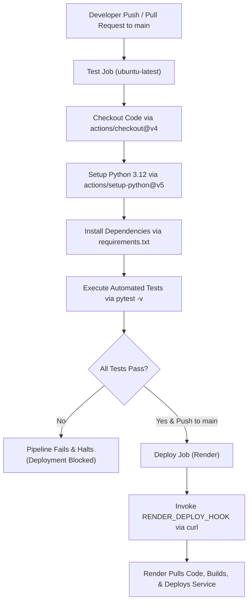

# Cloud-Based Application Deployment and Monitoring System

[](https://www.python.org/)
[](https://flask.palletsprojects.com/)
[](https://cloud-monitoring-system.onrender.com)
[](https://github.com/lhragavendhar5-art/cloud-monitoring-system/actions)
[](https://opensource.org/licenses/MIT)

> 🌐 **Live Cloud Deployment**: [https://cloud-monitoring-system.onrender.com](https://cloud-monitoring-system.onrender.com)  
> 📊 **Live Telemetry API**: [https://cloud-monitoring-system.onrender.com/metrics](https://cloud-monitoring-system.onrender.com/metrics)  
> 🩺 **Live Health Probe**: [https://cloud-monitoring-system.onrender.com/health](https://cloud-monitoring-system.onrender.com/health)  
> 📋 **Evaluation & Performance Testing**: [https://cloud-monitoring-system.onrender.com/evaluation](https://cloud-monitoring-system.onrender.com/evaluation)

A lightweight, production-ready Cloud-Based Application Deployment and Monitoring System developed in Python with Flask and Gunicorn. The system features an interactive real-time observability dashboard, comprehensive telemetry API endpoints, automated CI/CD pipelines via GitHub Actions, and containerless cloud deployment to Render.

---

## 1. Overview

The **Cloud-Based Application Deployment and Monitoring System** provides end-to-end monitoring and deployment automation for web services. It addresses the need for real-time visibility into application health, performance metrics, and error rates without the overhead of heavy third-party monitoring agents. 

Built with Flask and deployed using Gunicorn on Render's cloud infrastructure, the system continuously aggregates runtime metrics (request volume, latency percentiles, error rates) and exposes both human-facing dashboards and machine-readable JSON telemetry endpoints for cloud orchestrators.

---

## 2. Features

- **Interactive Monitoring Dashboard**: Web-based interface displaying real-time metrics, system uptime, request counters, error counts, and recent traffic logs.
- **Health Check Endpoint (`/health`)**: Machine-readable JSON endpoint designed for cloud orchestrator liveness and readiness probes.
- **Operational Metrics Engine (`/metrics`)**: Low-latency in-memory telemetry collecting total requests, success/error rates, and min/average/max response times.
- **Recent Activity Telemetry (`/api/activity`)**: Rolling window of recent HTTP requests and response latency distributions.
- **Configurable Fault Injection (`/simulate-error`)**: Secure, guarded diagnostic endpoint to validate alerting and failure handling (disabled by default).
- **HTTP Security Hardening**: Defense-in-depth HTTP response headers (`X-Content-Type-Options: nosniff`, `X-Frame-Options: SAMEORIGIN`) and sanitized JSON error handlers.
- **Automated CI/CD Pipeline**: GitHub Actions workflow running automated unit and integration tests with `pytest` prior to triggering zero-downtime deployment.
- **Production WSGI Integration**: Full compatibility with Gunicorn for concurrent request handling in cloud environments.

---

## 3. Technology Stack

| Technology | Purpose |
| :--- | :--- |
| **Python 3.12** | Core application programming language and execution environment |
| **Flask 3.1.1** | Micro-framework handling HTTP routing, request hooks, and API endpoints |
| **Gunicorn 23.0.0** | Production WSGI HTTP server managing worker concurrency |
| **pytest 8.3.5** | Test execution framework for automated unit and integration testing |
| **GitHub Actions** | Continuous integration and deployment orchestration |
| **Render** | Cloud hosting platform for web application hosting and deploy hooks |

---

## 4. Project Structure

```text
.
├── .github/
│   └── workflows/
│       └── deploy.yml        # CI/CD pipeline definition for test and deployment
├── templates/
│   ├── dashboard.html        # Real-time monitoring dashboard template
│   └── evaluation.html       # System evaluation & architecture review template
├── .gitignore                # Git ignore patterns for dependencies and caches
├── app.py                    # Main Flask application and metrics telemetry engine
├── README.md                 # Complete project and deployment documentation
├── requirements.txt          # Production and development dependencies
└── test_app.py               # Comprehensive pytest test suite
```

---

## 5. Local Setup

Follow these steps to run the application locally on your machine.

### Prerequisites
- Python 3.10+ (Python 3.12 recommended)
- Git

### Step-by-Step Instructions

1. **Clone the repository:**
   ```bash
   git clone <repository-url>
   cd CC
   ```

2. **Create and activate a virtual environment:**
   - **Linux / macOS:**
     ```bash
     python3 -m venv venv
     source venv/bin/activate
     ```
   - **Windows (PowerShell):**
     ```powershell
     python -m venv venv
     .\venv\Scripts\Activate.ps1
     ```
   - **Windows (Command Prompt):**
     ```cmd
     python -m venv venv
     venv\Scripts\activate.bat
     ```

3. **Install dependencies:**
   ```bash
   pip install -r requirements.txt
   ```

4. **Run the application:**
   ```bash
   python app.py
   ```

5. **Access the application:**
   Open your browser and navigate to:
   [http://localhost:5000](http://localhost:5000)

---

## 6. Running Tests

The test suite validates route accessibility, telemetry calculations, JSON formatting, security headers, and fault tolerance using `pytest`.

Run all tests with verbose output:

```bash
pytest -v
```

### Expected Output Format

```text
============================= test session starts =============================
platform win32 -- Python 3.12.x, pytest-8.3.5, pluggy-1.x.x -- ...
cachedir: .pytest_cache
rootdir: c:\Users\Ragav\OneDrive\Documents\CC
collected 19 items

test_app.py::test_health_endpoint_status PASSED                          [  5%]
test_app.py::test_health_endpoint_json_format PASSED                     [ 10%]
test_app.py::test_health_endpoint_content_type PASSED                    [ 15%]
test_app.py::test_metrics_endpoint_status PASSED                         [ 21%]
test_app.py::test_metrics_endpoint_json_format PASSED                    [ 26%]
test_app.py::test_metrics_initial_values PASSED                          [ 31%]
test_app.py::test_dashboard_renders PASSED                               [ 36%]
test_app.py::test_dashboard_content_type PASSED                          [ 42%]
test_app.py::test_dashboard_contains_key_elements PASSED                 [ 47%]
test_app.py::test_activity_endpoint_status PASSED                        [ 52%]
test_app.py::test_activity_endpoint_json_format PASSED                   [ 57%]
test_app.py::test_activity_recent_requests_is_list PASSED                [ 63%]
test_app.py::test_simulate_error_disabled_by_default PASSED             [ 68%]
test_app.py::test_simulate_error_returns_json_when_disabled PASSED      [ 73%]
test_app.py::test_evaluation_page_renders PASSED                         [ 78%]
test_app.py::test_evaluation_page_content PASSED                         [ 84%]
test_app.py::test_404_handler PASSED                                     [ 89%]
test_app.py::test_404_returns_json PASSED                                [ 94%]
test_app.py::test_metrics_increment_after_request PASSED                  [100%]
test_app.py::test_security_headers PASSED                                [100%]

============================== 19 passed in 0.xxs ==============================
```

---

## 7. Deployment to Render

To deploy the application to Render with automated GitHub Actions continuous delivery:

1. **Push code to GitHub:**
   Commit and push all project files to the `main` branch of your GitHub repository:
   ```bash
   git add .
   git commit -m "Initialize deployment and monitoring system"
   git push origin main
   ```

2. **Create a new Web Service on Render:**
   - Log into your [Render Dashboard](https://dashboard.render.com/).
   - Click **New +** and select **Web Service**.

3. **Connect GitHub repository:**
   - Select your Git provider and choose the repository containing this project.

4. **Configure Service Settings:**
   - **Name:** `cloud-monitor` (or your preferred unique service name)
   - **Environment:** `Python 3`
   - **Region:** Select the closest region (e.g., Oregon, Frankfurt)
   - **Branch:** `main`
   - **Build Command:** `pip install -r requirements.txt`
   - **Start Command:** `gunicorn app:app`
   - **Health Check Path:** `/health`

5. **Set Auto-Deploy to OFF:**
   - In the service settings under **Auto-Deploy**, set the toggle to **No / OFF**.
   - This ensures deployments are triggered solely when GitHub Actions tests pass.

6. **Get Deploy Hook URL:**
   - Under **Settings** > **Deploy Hook**, generate or copy the Webhook URL (format: `https://api.render.com/deploy/srv-xxxxxx?key=yyyyyy`).

7. **Add Secret to GitHub Repository:**
   - Go to your GitHub repository: **Settings** > **Secrets and variables** > **Actions**.
   - Click **New repository secret**.
   - Name: `RENDER_DEPLOY_HOOK`
   - Secret Value: Paste the Deploy Hook URL copied from Render.

8. **Trigger Automated Deployment:**
   - Push any commit to the `main` branch or trigger manually via **Actions** > **Run workflow**.

---

## 8. CI/CD Pipeline

The Continuous Integration and Continuous Deployment pipeline is orchestrated by GitHub Actions in `.github/workflows/deploy.yml`:



### Pipeline Workflow Stages:
1. **Automated Testing (`test` job)**:
   - Triggers on every `push` and `pull_request` targeting the `main` branch, as well as manual triggers via `workflow_dispatch`.
   - Spins up a clean `ubuntu-latest` runner with Python 3.12.
   - Installs dependencies from `requirements.txt` and executes `pytest -v`.
   - Protects the production service by failing immediately if any test fails.
2. **Deploy Trigger (`deploy` job)**:
   - Depends directly on the `test` job completing successfully (`needs: test`).
   - Runs exclusively for direct push events to `refs/heads/main`.
   - Calls the secret Render deploy hook using `curl` to initiate the cloud deployment without exposing API keys.

---

## 9. API Endpoints

| Route | HTTP Method | Description | Response Type | Status Code |
| :--- | :--- | :--- | :--- | :--- |
| `/` | `GET` | Web-based real-time telemetry and health monitoring dashboard | `text/html` | `200 OK` |
| `/health` | `GET` | Health status probe reporting uptime, version, and status | `application/json` | `200 OK` |
| `/metrics` | `GET` | Operational telemetry (counters, error rate, min/avg/max latency) | `application/json` | `200 OK` |
| `/api/activity` | `GET` | Recent request activity sliding window and response time samples | `application/json` | `200 OK` |
| `/simulate-error` | `GET` | Diagnostic error route (enabled via `ENABLE_ERROR_SIMULATION`) | `application/json` | `403 Forbidden` / `500 Error` |
| `/evaluation` | `GET` | System architecture, evaluation, and operational report page | `text/html` | `200 OK` |
| `/*` (Not found) | `ALL` | Global fallback handler for undefined paths | `application/json` | `404 Not Found` |

---

## 10. Monitoring

### Dashboard Operation
The dashboard at `/` provides an administrative overview of service health:
- It uses lightweight asynchronous JavaScript to poll `/metrics` and `/api/activity` without full page refreshes.
- It presents visual indicators for current uptime, total processed requests, error percentages, and latency distribution.

### Metrics Collected
- **Total Requests (`total_requests`)**: Cumulative counter of incoming HTTP requests handled by the instance.
- **Successful Requests (`successful_requests`)**: Counter of requests yielding 2xx or 3xx HTTP status codes.
- **Error Count (`error_count`)**: Counter of requests yielding 4xx client errors or 5xx server errors.
- **Latency Statistics**:
  - `average_response_time_ms`: Arithmetic mean of response times across tracked requests.
  - `min_response_time_ms`: Lowest observed response time in milliseconds.
  - `max_response_time_ms`: Highest observed response time in milliseconds.
- **System Uptime (`uptime_seconds`)**: Elapsed seconds since the application process started.
- **Recent Activity Window**: Rolling buffer containing metadata (timestamp, HTTP method, path, status code, latency) of the last processed requests.

---

## 11. Security

The application incorporates standard web application security practices:

- **Security Response Headers**: Every response generated by the application includes:
  - `X-Content-Type-Options: nosniff`: Instructs browsers not to override the declared MIME type, mitigating MIME-confusion attacks.
  - `X-Frame-Options: SAMEORIGIN`: Prevents the site from being embedded in unauthorized frames or iframes, mitigating clickjacking.
- **Restricted Diagnostic Controls**: The `/simulate-error` endpoint is locked down by default. It requires the environment variable `ENABLE_ERROR_SIMULATION` to be set to a truthy value; otherwise, it returns `403 Forbidden`.
- **Sanitized Error Responses**: Custom error handlers intercept 404 and 500 conditions, returning structured JSON payloads instead of exposing Python stack traces or server internals.
- **Credential & Secret Protection**: Sensitive deployment webhooks are kept out of the source tree and stored in GitHub Encrypted Secrets (`RENDER_DEPLOY_HOOK`).

---

## 12. Cost Analysis

The entire application and CI/CD lifecycle operates within provider Free Tiers:

| Service / Resource | Provider | Free Tier Allocation | Estimated Monthly Cost |
| :--- | :--- | :--- | :--- |
| **Web Service Hosting** | Render | 512 MB RAM, 0.1 vCPU, 750 free instance hours / month | $0.00 |
| **CI/CD Build Runners** | GitHub Actions | 2,000 free Linux build minutes / month | $0.00 |
| **Source Code Repository** | GitHub | Unlimited public and private repositories | $0.00 |
| **SSL / TLS Certificate** | Render / Let's Encrypt | Fully managed automatic TLS certificates | $0.00 |
| **Total Cost** | — | — | **$0.00 / month** |

---

## 13. Scalability

- **Stateless Application Tier**: The Flask web application retains no persistent state across HTTP requests, allowing it to scale horizontally behind cloud load balancers.
- **Concurrency Model**: Running on Gunicorn allows multi-process worker configurations (e.g., `gunicorn -w 4 app:app`) to maximize CPU utilization and handle concurrent client requests efficiently.
- **Telemetry Architecture**: The lightweight in-memory metrics collector incurs negligible processing overhead per request. For multi-instance horizontal scaling, the metrics layer can be adapted to emit to an external aggregator such as Prometheus, StatsD, or Redis.

---

## 14. Important Notes

- **In-Memory Metrics Notice**: Operational metrics (`total_requests`, `error_count`, latency records) are stored in memory within the active Python process. If the application server restarts, crashes, or redeploys, these counters reset to initial zero values.
- **Render Free Tier Sleep Policy**: Render puts free web services into a sleeping state after 15 minutes of inbound network inactivity.
- **Cold Starts**: When an incoming request arrives while the service is spun down, Render will boot the container. This causes an initial cold start latency delay of approximately 30–50 seconds for the first request. Subsequent requests will be served with normal sub-second response times.

---

## 15. License

This project is licensed under the [MIT License](https://opensource.org/licenses/MIT).
