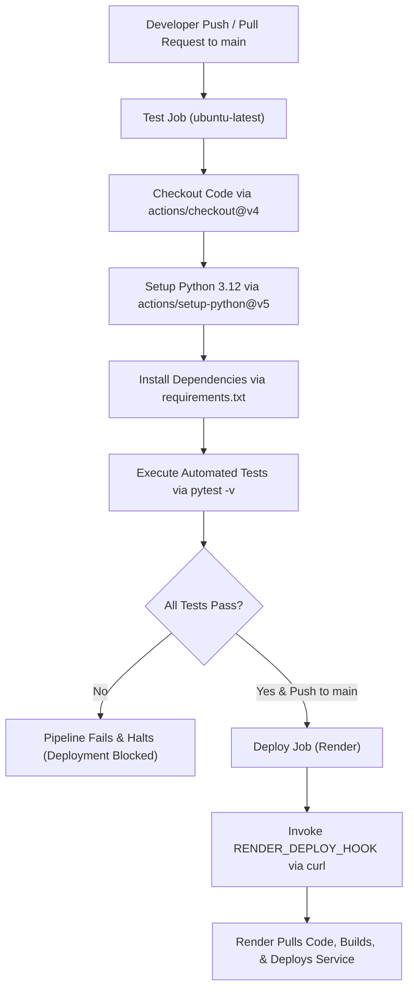

# Cloud-Based Application Deployment and Monitoring System

[](https://www.python.org/)
[](https://flask.palletsprojects.com/)
[](https://cloud-monitoring-system.onrender.com)
[](https://github.com/lhragavendhar5-art/cloud-monitoring-system/actions)
[](https://opensource.org/licenses/MIT)

> 🌐 **Live Cloud Deployment**: [https://cloud-monitoring-system.onrender.com](https://cloud-monitoring-system.onrender.com)  
> 📊 **Live Telemetry API**: [https://cloud-monitoring-system.onrender.com/metrics](https://cloud-monitoring-system.onrender.com/metrics)  
> 🩺 **Live Health Probe**: [https://cloud-monitoring-system.onrender.com/health](https://cloud-monitoring-system.onrender.com/health)  
> 📋 **Evaluation & Performance Testing**: [https://cloud-monitoring-system.onrender.com/evaluation](https://cloud-monitoring-system.onrender.com/evaluation)

A lightweight, production-ready Cloud-Based Application Deployment and Monitoring System developed in Python with Flask and Gunicorn. The system features an interactive real-time observability dashboard, comprehensive telemetry API endpoints, automated CI/CD pipelines via GitHub Actions, and containerless cloud deployment to Render.

---

## 1. Overview

The **Cloud-Based Application Deployment and Monitoring System** provides end-to-end monitoring and deployment automation for web services. It addresses the need for real-time visibility into application health, performance metrics, and error rates without the overhead of heavy third-party monitoring agents. 

Built with Flask and deployed using Gunicorn on Render's cloud infrastructure, the system continuously aggregates runtime metrics (request volume, latency percentiles, error rates) and exposes both human-facing dashboards and machine-readable JSON telemetry endpoints for cloud orchestrators.

---

## 2. Features

- **Interactive Monitoring Dashboard**: Web-based interface displaying real-time metrics, system uptime, request counters, error counts, client error counts, and recent traffic logs.
- **Interactive Demo Control Panel**: In-dashboard control center allowing live demonstration of 6 operational scenarios (Normal Traffic, Server Errors, Slow Responses, Client Errors, Service Recovery, and Telemetry Reset).
- **Dynamic Health Status (`/health`)**: Machine-readable JSON probe evaluating application status against configurable error-rate and latency thresholds (`healthy`, `degraded`, `unhealthy`). Returns HTTP 200 or HTTP 503.
- **Operational Metrics Engine (`/metrics`)**: Low-latency in-memory telemetry collecting total requests, success/error rates, client errors (4xx), server errors (5xx), and min/average/max response times.
- **Recent Activity Telemetry (`/api/activity`)**: Rolling window of recent HTTP requests and response latency distributions.
- **Protected Fault Injection & Demo API (`/api/demo/*`, `/simulate-error`)**: Secure, guarded diagnostic endpoints protected by environment flags and optional access tokens.
- **HTTP Security Hardening**: Defense-in-depth HTTP response headers (`X-Content-Type-Options: nosniff`, `X-Frame-Options: SAMEORIGIN`) and sanitized JSON error handlers.
- **Automated CI/CD Pipeline**: GitHub Actions workflow running 32 automated unit and integration tests with `pytest` prior to triggering zero-downtime deployment.
- **Production WSGI Integration**: Full compatibility with Gunicorn for concurrent request handling in cloud environments.

---

## 3. Technology Stack

| Technology | Purpose |
| :--- | :--- |
| **Python 3.12** | Core application programming language and execution environment |
| **Flask 3.1.1** | Micro-framework handling HTTP routing, request hooks, and API endpoints |
| **Gunicorn 23.0.0** | Production WSGI HTTP server managing worker concurrency |
| **pytest 8.3.5** | Test execution framework for automated unit and integration testing |
| **GitHub Actions** | Continuous integration and deployment orchestration |
| **Render** | Cloud hosting platform for web application hosting and deploy hooks |

---

## 4. Project Structure

```text
.
├── .github/
│   └── workflows/
│       └── deploy.yml        # CI/CD pipeline definition for test and deployment
├── templates/
│   ├── dashboard.html        # Real-time monitoring dashboard template
│   └── evaluation.html       # System evaluation & architecture review template
├── .gitignore                # Git ignore patterns for dependencies and caches
├── app.py                    # Main Flask application and metrics telemetry engine
├── README.md                 # Complete project and deployment documentation
├── requirements.txt          # Production and development dependencies
└── test_app.py               # Comprehensive pytest test suite
```

---

## 5. Local Setup

Follow these steps to run the application locally on your machine.

### Prerequisites
- Python 3.10+ (Python 3.12 recommended)
- Git

### Step-by-Step Instructions

1. **Clone the repository:**
   ```bash
   git clone <repository-url>
   cd CC
   ```

2. **Create and activate a virtual environment:**
   - **Linux / macOS:**
     ```bash
     python3 -m venv venv
     source venv/bin/activate
     ```
   - **Windows (PowerShell):**
     ```powershell
     python -m venv venv
     .\venv\Scripts\Activate.ps1
     ```
   - **Windows (Command Prompt):**
     ```cmd
     python -m venv venv
     venv\Scripts\activate.bat
     ```

3. **Install dependencies:**
   ```bash
   pip install -r requirements.txt
   ```

4. **Run the application:**
   ```bash
   python app.py
   ```

5. **Access the application:**
   Open your browser and navigate to:
   [http://localhost:5000](http://localhost:5000)

---

## 6. Running Tests

The test suite validates route accessibility, telemetry calculations, JSON formatting, security headers, and fault tolerance using `pytest`.

Run all tests with verbose output:

```bash
pytest -v
```

### Expected Output Format
 
```text
============================= test session starts =============================
platform win32 -- Python 3.12+ / 3.14+, pytest-8.3.5, pluggy-1.6.0
cachedir: .pytest_cache
rootdir: c:\Users\Ragav\OneDrive\Documents\CC
collected 32 items

test_app.py::test_health_endpoint_status PASSED                          [  3%]
test_app.py::test_health_endpoint_json_format PASSED                     [  6%]
test_app.py::test_health_updates_last_health_check PASSED                [  9%]
test_app.py::test_health_status_degraded_on_error_rate PASSED            [ 12%]
test_app.py::test_health_status_unhealthy_on_critical_error_rate PASSED  [ 15%]
test_app.py::test_metrics_endpoint_status PASSED                         [ 18%]
test_app.py::test_metrics_endpoint_json_format PASSED                    [ 21%]
test_app.py::test_metrics_initial_empty_state PASSED                     [ 25%]
test_app.py::test_dashboard_renders PASSED                               [ 28%]
test_app.py::test_dashboard_contains_key_elements PASSED                 [ 31%]
test_app.py::test_evaluation_page_renders PASSED                         [ 34%]
test_app.py::test_evaluation_page_content PASSED                         [ 37%]
test_app.py::test_activity_endpoint_status PASSED                        [ 40%]
test_app.py::test_activity_endpoint_json_format PASSED                   [ 43%]
test_app.py::test_metrics_increment_on_monitored_traffic PASSED          [ 46%]
test_app.py::test_excluded_paths_do_not_inflate_metrics PASSED           [ 50%]
test_app.py::test_response_time_statistics_calculation PASSED            [ 53%]
test_app.py::test_simulate_error_disabled_by_default PASSED              [ 56%]
test_app.py::test_simulate_error_when_enabled PASSED                     [ 59%]
test_app.py::test_404_handler_structure PASSED                           [ 62%]
test_app.py::test_404_not_counted_as_server_error PASSED                 [ 65%]
test_app.py::test_security_headers_present PASSED                        [ 68%]
test_app.py::test_demo_status_endpoint PASSED                            [ 71%]
test_app.py::test_demo_controls_disabled_by_default PASSED               [ 75%]
test_app.py::test_demo_controls_token_authorization PASSED               [ 78%]
test_app.py::test_demo_input_bounds_validation PASSED                    [ 81%]
test_app.py::test_demo_normal_traffic_scenario PASSED                    [ 84%]
test_app.py::test_demo_server_error_scenario PASSED                      [ 87%]
test_app.py::test_demo_client_error_scenario PASSED                      [ 90%]
test_app.py::test_demo_slow_response_scenario PASSED                     [ 93%]
test_app.py::test_demo_recovery_scenario PASSED                          [ 96%]
test_app.py::test_demo_reset_scenario PASSED                             [100%]

============================= 32 passed in 0.30s ==============================
```

---

## 7. Deployment to Render

To deploy the application to Render with automated GitHub Actions continuous delivery:

1. **Push code to GitHub:**
   Commit and push all project files to the `main` branch of your GitHub repository:
   ```bash
   git add .
   git commit -m "Initialize deployment and monitoring system"
   git push origin main
   ```

2. **Create a new Web Service on Render:**
   - Log into your [Render Dashboard](https://dashboard.render.com/).
   - Click **New +** and select **Web Service**.

3. **Connect GitHub repository:**
   - Select your Git provider and choose the repository containing this project.

4. **Configure Service Settings:**
   - **Name:** `cloud-monitor` (or your preferred unique service name)
   - **Environment:** `Python 3`
   - **Region:** Select the closest region (e.g., Oregon, Frankfurt)
   - **Branch:** `main`
   - **Build Command:** `pip install -r requirements.txt`
   - **Start Command:** `gunicorn app:app`
   - **Health Check Path:** `/health`

5. **Set Auto-Deploy to OFF:**
   - In the service settings under **Auto-Deploy**, set the toggle to **No / OFF**.
   - This ensures deployments are triggered solely when GitHub Actions tests pass.

6. **Get Deploy Hook URL:**
   - Under **Settings** > **Deploy Hook**, generate or copy the Webhook URL (format: `https://api.render.com/deploy/srv-xxxxxx?key=yyyyyy`).

7. **Add Secret to GitHub Repository:**
   - Go to your GitHub repository: **Settings** > **Secrets and variables** > **Actions**.
   - Click **New repository secret**.
   - Name: `RENDER_DEPLOY_HOOK`
   - Secret Value: Paste the Deploy Hook URL copied from Render.

8. **Trigger Automated Deployment:**
   - Push any commit to the `main` branch or trigger manually via **Actions** > **Run workflow**.

---

## 8. CI/CD Pipeline

The Continuous Integration and Continuous Deployment pipeline is orchestrated by GitHub Actions in `.github/workflows/deploy.yml`:



### Pipeline Workflow Stages:
1. **Automated Testing (`test` job)**:
   - Triggers on every `push` and `pull_request` targeting the `main` branch, as well as manual triggers via `workflow_dispatch`.
   - Spins up a clean `ubuntu-latest` runner with Python 3.12.
   - Installs dependencies from `requirements.txt` and executes `pytest -v`.
   - Protects the production service by failing immediately if any test fails.
2. **Deploy Trigger (`deploy` job)**:
   - Depends directly on the `test` job completing successfully (`needs: test`).
   - Runs exclusively for direct push events to `refs/heads/main`.
   - Calls the secret Render deploy hook using `curl` to initiate the cloud deployment without exposing API keys.

---

## 9. API Endpoints

| Route | HTTP Method | Description | Response Type | Status Code |
| :--- | :--- | :--- | :--- | :--- |
| `/` | `GET` | Web-based real-time telemetry and health monitoring dashboard | `text/html` | `200 OK` |
| `/health` | `GET` | Dynamic health status probe (`healthy`, `degraded`, `unhealthy`) based on real telemetry | `application/json` | `200 OK` / `503 Service Unavailable` |
| `/metrics` | `GET` | Operational telemetry (counters, 4xx/5xx errors, error rate, min/avg/max latency) | `application/json` | `200 OK` |
| `/api/activity` | `GET` | Recent request activity sliding window and response time samples | `application/json` | `200 OK` |
| `/api/demo/status` | `GET` | Status of demo control panel and access token protection | `application/json` | `200 OK` |
| `/api/demo/traffic` | `POST` | Generate bounded normal traffic requests (1–25 requests) | `application/json` | `200 OK` / `403 Forbidden` |
| `/api/demo/server-error` | `POST` | Trigger controlled HTTP 500 server fault injection | `application/json` | `500 Error` / `403 Forbidden` |
| `/api/demo/slow-response` | `POST` | Simulate controlled latency with bounded delay (50–2000 ms) | `application/json` | `200 OK` / `403 Forbidden` |
| `/api/demo/client-error` | `POST` | Trigger controlled HTTP 404 client error | `application/json` | `404 Not Found` / `403 Forbidden` |
| `/api/demo/recovery` | `POST` | Recovery verification test generating successful requests | `application/json` | `200 OK` / `403 Forbidden` |
| `/api/demo/reset` | `POST` | Reset in-memory telemetry counters and buffers | `application/json` | `200 OK` / `403 Forbidden` |
| `/simulate-error` | `GET` | Diagnostic error route (enabled via `ENABLE_ERROR_SIMULATION`) | `application/json` | `403 Forbidden` / `500 Error` |
| `/evaluation` | `GET` | System architecture, evaluation, and operational report page | `text/html` | `200 OK` |
| `/*` (Not found) | `ALL` | Global fallback handler for undefined paths | `application/json` | `404 Not Found` |

---

## 10. Monitoring & Dynamic Health Evaluation

### Dashboard Operation
The dashboard at `/` provides an administrative overview of service health:
- It uses lightweight asynchronous JavaScript to poll `/metrics` and `/api/activity` every 10–15 seconds without full page refreshes.
- It presents visual indicators for current uptime, total processed requests, error percentages, client errors, and latency distribution.
- Live telemetry is synchronized directly from real backend measurements; no mock values or fabricated counters are used.

### Metrics Collected
- **Total Requests (`total_requests`)**: Cumulative counter of incoming HTTP requests handled by the instance (excluding internal monitoring probes `/health`, `/metrics`, and `/api/*`).
- **Successful Requests (`successful_requests`)**: Counter of requests yielding 2xx or 3xx HTTP status codes.
- **Client Error Count (`client_error_count`)**: Counter of requests resulting in 4xx client errors (e.g., 404 Not Found, 403 Forbidden).
- **Server Error Count (`server_error_count` / `error_count`)**: Counter of requests resulting in 5xx internal server errors.
- **Error Rate (`error_rate`)**: Ratio of 5xx server errors to total monitored requests (`server_error_count / total_requests`). Displayed as `0.00%` when no requests exist. 4xx errors are excluded from server error rate.
- **Latency Statistics**:
  - `average_response_time_ms`: Arithmetic mean of response times across tracked requests.
  - `min_response_time_ms`: Lowest observed response time in milliseconds.
  - `max_response_time_ms`: Highest observed response time in milliseconds.
- **System Uptime (`uptime_seconds`)**: Elapsed seconds since the application process started.
- **Health Status (`health_status`)**: Current application health classification (`healthy`, `degraded`, or `unhealthy`).
- **Recent Activity Window**: Rolling buffer containing metadata (timestamp, HTTP method, path, status code, latency) of the last processed requests.

### Dynamic Health Thresholds
The `/health` probe dynamically evaluates application health against configurable operational thresholds:
- **`healthy`**: Error rate $\le 10\%$ and average response time $\le 500\text{ ms}$. Returns HTTP 200.
- **`degraded`**: Error rate $> 10\%$ or average response time $> 500\text{ ms}$. Returns HTTP 200 with diagnostic warning.
- **`unhealthy`**: Error rate $> 30\%$ or average response time $> 1200\text{ ms}$. Returns HTTP 503 Service Unavailable.

Thresholds are customizable via environment variables:
- `HEALTH_DEGRADED_ERROR_RATE` (default `0.10`)
- `HEALTH_UNHEALTHY_ERROR_RATE` (default `0.30`)
- `HEALTH_DEGRADED_LATENCY_MS` (default `500.0`)
- `HEALTH_UNHEALTHY_LATENCY_MS` (default `1200.0`)

---

## 11. Interactive Demo Scenarios

The dashboard features an interactive **Demo Scenarios** control center to demonstrate real cloud operational events live:

1. **Normal Traffic**:
   - Sends a user-configured batch of real HTTP requests (1 to 25) to `/api/demo/traffic`.
   - Each request is processed through the WSGI pipeline, measured, and appended to the activity stream and latency charts.
2. **Simulate Server Errors (500)**:
   - Triggers an authentic HTTP 500 internal server error via `/api/demo/server-error`.
   - Increments `server_error_count`, recalculates `error_rate`, triggers dynamic health status evaluation, and flashes a warning toast.
3. **Simulate Slow Responses (Latency Injection)**:
   - Injects a controlled server delay (50 ms to 2000 ms) via `/api/demo/slow-response`.
   - The response timer measures genuine elapsed wall-clock execution time and updates average and maximum latency metrics.
4. **Simulate Client Errors (404)**:
   - Generates a controlled HTTP 404 response via `/api/demo/client-error`.
   - Increments `client_error_count` without affecting the 5xx server error rate or triggering unnecessary server failure alerts.
5. **Recovery Test**:
   - Generates 5 consecutive successful requests to verify service restoration.
   - Updates health status while retaining cumulative historical metrics, demonstrating standard cloud telemetry behavior.
6. **Reset Demo Metrics**:
   - Resets all in-memory counters (`total_requests`, `server_error_count`, `client_error_count`, latency records) to zero upon user confirmation.
   - Clears activity tables and resets charts to clean baseline states.

### Demo Security & Configuration
- **Disabled by Default**: Demo endpoints return `403 Forbidden` unless `ENABLE_DEMO_MODE=true` (or `ENABLE_ERROR_SIMULATION=true`).
- **Optional Access Token**: Set `DEMO_ACCESS_TOKEN=<secret>` to enforce token authorization. The dashboard includes a token input field that transmits the token via the `X-Demo-Token` header.
- **Server-Side Input Validation**: Traffic counts are bounded to 1–25 requests; latency delays are bounded to 50–2000 ms to prevent denial-of-service conditions.

---

## 12. Practical Examination Demonstration Guide

Follow this sequence to demonstrate each cloud monitoring capability during evaluation:

### Step 1: Baseline Verification
1. Open the live dashboard at [https://cloud-monitoring-system.onrender.com](https://cloud-monitoring-system.onrender.com).
2. Point out the **Health Status** badge (`Healthy`), **Process Uptime**, and clean initial counters.
3. Open `/health` in another tab to show the JSON health probe with `status: "healthy"` and `diagnostics`.

### Step 2: Normal Traffic Demonstration
1. In the **Demo Scenarios** panel, set **Request Count** to `5` and click **Generate Normal Traffic**.
2. Observe the counters increment: **Total Requests** increases by 5, **Successful Requests** increases by 5, and the **Response Time Chart** updates with actual millisecond latency values.
3. Point out the new entries in the **Recent Request Activity** table.

### Step 3: Latency & Slow Response Demonstration
1. Set the **Delay (ms)** slider to `800` ms and click **Inject Latency**.
2. Notice the brief delay while the request completes.
3. Observe **Average Response Time** and **Maximum Response Time** jump to reflect the measured 800+ ms latency.
4. If average latency exceeds the threshold, observe the **Health Status** badge update to `Degraded`.

### Step 4: Server Error & Health Degradation Demonstration
1. Click **Inject Server Error (500)**.
2. Observe the **Server Errors (5xx)** card increment and **Error Rate** recalculate.
3. Observe the system status transition based on error percentage: if error rate exceeds 10%, the health badge updates to `Degraded`; above 30%, it transitions to `Unhealthy`.
4. Refresh `/health` to show the HTTP status code (HTTP 503 when unhealthy) and updated diagnostics JSON.

### Step 5: Client Error Separation (4xx vs 5xx)
1. Click **Trigger Client Error (404)**.
2. Observe that **Client Errors (4xx)** increments, but **Server Errors (5xx)** remains unchanged.
3. Explain that client errors represent malformed or missing client requests and do not count toward internal service failure rates.

### Step 6: Recovery Test Demonstration
1. Click **Run Recovery Test**.
2. The system executes a batch of 5 successful requests.
3. As successful requests dilute the error percentage below the degraded threshold, observe the **Health Status** return to `Healthy`.
4. Point out that historical error counts are preserved in cumulative metrics until explicitly reset.

### Step 7: Telemetry Reset
1. Click **Reset Demo Metrics** and confirm the prompt.
2. All counters return to zero, charts clear to the initial empty state, and uptime continues incrementing uninterrupted.

---

## 13. Security

The application incorporates standard web application security practices:

- **Security Response Headers**: Every response generated by the application includes:
  - `X-Content-Type-Options: nosniff`: Instructs browsers not to override the declared MIME type, mitigating MIME-confusion attacks.
  - `X-Frame-Options: SAMEORIGIN`: Prevents the site from being embedded in unauthorized frames or iframes, mitigating clickjacking.
- **Restricted Diagnostic Controls**: Demo endpoints and `/simulate-error` are locked down by default. They require `ENABLE_DEMO_MODE=true` or `ENABLE_ERROR_SIMULATION=true`, and support optional access tokens via `DEMO_ACCESS_TOKEN`.
- **Sanitized Error Responses**: Custom error handlers intercept 404 and 500 conditions, returning structured JSON payloads instead of exposing Python stack traces or server internals.
- **Credential & Secret Protection**: Sensitive deployment webhooks are kept out of the source tree and stored in GitHub Encrypted Secrets (`RENDER_DEPLOY_HOOK`).

---

## 14. Cost Analysis

The entire application and CI/CD lifecycle operates within provider Free Tiers:

| Service / Resource | Provider | Free Tier Allocation | Estimated Monthly Cost |
| :--- | :--- | :--- | :--- |
| **Web Service Hosting** | Render | 512 MB RAM, 0.1 vCPU, 750 free instance hours / month | $0.00 |
| **CI/CD Build Runners** | GitHub Actions | 2,000 free Linux build minutes / month | $0.00 |
| **Source Code Repository** | GitHub | Unlimited public and private repositories | $0.00 |
| **SSL / TLS Certificate** | Render / Let's Encrypt | Fully managed automatic TLS certificates | $0.00 |
| **Total Cost** | — | — | **$0.00 / month** |

---

## 15. Scalability

- **Stateless Application Tier**: The Flask web application retains no persistent state across HTTP requests, allowing it to scale horizontally behind cloud load balancers.
- **Concurrency Model**: Running on Gunicorn allows multi-process worker configurations (e.g., `gunicorn -w 4 app:app`) to maximize CPU utilization and handle concurrent client requests efficiently.
- **Telemetry Architecture**: The lightweight in-memory metrics collector incurs negligible processing overhead per request. For multi-instance horizontal scaling, the metrics layer can be adapted to emit to an external aggregator such as Prometheus, StatsD, or Redis.

---

## 16. Important Notes & Production Considerations
 
- **In-Memory Metrics Isolation**: Operational metrics (`total_requests`, `error_count`, latency records) are maintained in process memory within the running Python interpreter:
  - If the web service restarts, redeploys, or crashes, in-memory counters reset to initial zero values.
  - In multi-worker WSGI configurations (such as `gunicorn -w 4 app:app`), each worker process maintains its own isolated in-memory telemetry. For multi-worker or multi-server enterprise deployments, an external centralized datastore (e.g., Redis, Prometheus, or TimescaleDB) should be utilized.
- **Render Free Tier Hosting Terms**: Render offers free-tier web services with an allocation of 750 free instance hours per month. These figures represent current cloud provider estimates and are subject to provider policy updates. Target prototype cost is ₹0 ($0.00) within these tier limits.
- **Cold Start Latency**: Under Render's free tier sleep policy, inactive web services spin down after 15 minutes of zero traffic. When a new request arrives, a container wake-up sequence occurs, which may introduce an estimated ~30–50 second latency delay for the initial request. Subsequent requests are handled with standard sub-second latency.
- **CI/CD Deployment Webhook Trigger**: The GitHub Actions deployment stage executes an HTTP POST request to the Render Deploy Hook. A successful HTTP response confirms that Render has queued the deployment trigger; it does not indicate that the remote container build, dependency installation, or rollout has concluded. Remote build status should be confirmed directly on the Render dashboard.

---

## 17. License

This project is licensed under the [MIT License](https://opensource.org/licenses/MIT).
